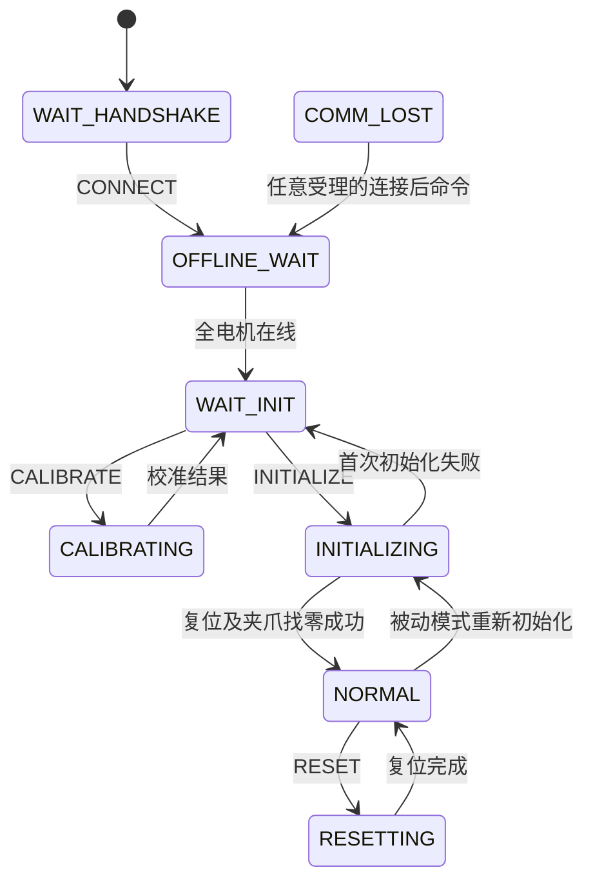

# PC Python 控制接口

接口版本：1。类型定义在 [`types.py`](../arx_x5_control/types.py)，运行适配器在 [`interfaces.py`](../arx_x5_control/interfaces.py)。本接口不是原 H7 二进制协议的编码实现。

## 控制循环

```python
result = controller.step(now_ms, commands=commands, motor_feedback=feedback)
```

`now_ms` 为非负整数毫秒，同一实例严格递增。首拍通常为 0。命令与反馈可为任意有限可迭代对象。调用由一个线程拥有；其他线程或进程的数据由未来适配器汇集后提交。

反馈采样时间必须与 `now_ms` 使用同一个单调时间域，且不大于当前时间。不能用本次出队时间给旧反馈重新计时。比该电机最近一次反馈更旧的样本被忽略，并增加 `stale_feedback_count`。

非法类型、臂号、数组维度、NaN/Inf 和未来反馈时间在更新状态前抛出异常。每臂待处理命令最多 7 条，与 H7 8 槽环形缓冲的有效容量一致；超出部分产生 `rejected` 事件。应用级命令在 2 ms 控制周期处理。

`TickResult` 的三个成员均为不可变元组：

| 成员 | 内容 | 处理要求 |
| --- | --- | --- |
| `motor_requests` | 电机操作和设定值 | 保持原顺序交付；不得只保留最后一条操作 |
| `feedback` | 250 Hz 机械臂反馈 | 可直接供同设备上层程序读取 |
| `events` | 状态、拒绝、初始化/复位/校准结果 | 用于判断操作是否受理或完成 |

控制更新以 2 ms 为目标；电机周期见迁移文档。晚到的调度只更新一次，到期电机不因错过相位而永久跳过；不会重放全部旧周期。`missed_motor_ticks`、`missed_command_ticks` 记录漏拍数。

## 命令

`Command(arm_id, kind, joint_angle=(), gripper_angle=0.0, joint_velocity=(), api_version=1)`。

`arm_id` 为 0 或 1。单臂实例只接受 0。`joint_angle` 固定按 j1…j6 排列，单位 deg；`joint_velocity` 单位 deg/s；`gripper_angle` 单位 deg。

| `CommandKind` | 允许状态及效果 | 原 H7 语义 |
| --- | --- | --- |
| `CONNECT` | 版本 1 连接确认；首次进入等待电机 | 0x01 握手语义，删除 FNV 和字节帧 |
| `HEARTBEAT` | 连接后更新本臂通信看门狗 | 将原“任意有效帧保活”定义为明确接口 |
| `INITIALIZE` | `WAIT_INIT`，或 `NORMAL` 的 STOP/DAMPING；全电机在线、复位偏差 ≤20° | 0x02：2 s 复位，然后夹爪找零 |
| `CALIBRATE` | `WAIT_INIT`；依次设六关节电机零点，不设夹爪零点 | 0x10；结果为 `calibrated` 事件 |
| `START` | `NORMAL` → RUN | 0x12 |
| `GRAVITY` | `NORMAL` → GRAVITY | 0x13 |
| `STOP` | `NORMAL` → STOP | 0x14 |
| `DAMPING` | `NORMAL` → DAMPING | 0x15 |
| `POSITION` | `NORMAL/RUN`；6 个角度及夹爪角度 | 0x16 |
| `POSITION_VELOCITY` | `NORMAL/RUN`；6 个角度、6 个速度及夹爪角度 | 0x17 |
| `RESET` | `NORMAL` 且全电机在线；只复位、不找零 | 0x18 |

非位置命令的角度/速度数组应为空。位置命令不接受额外速度数组；位置速度命令必须同时提供两组 6 元数组。位置目标会软限幅，然后经过 TD。外部速度直接覆盖 TD 速度，最终仍受电机速度量程限制。

连接前只有 `CONNECT` 生效。连接后合法但因状态不允许而被拒绝的命令，仍会刷新本臂的 3 s 看门狗，保持 H7 行为。重复 `CONNECT` 不会重新初始化机械臂。连接版本不匹配产生拒绝事件。

模式命令只在 `NORMAL` 受理，保留 H7 限制。需要中止整个控制程序时调用 `shutdown()`；不能把初始化期间发出的 `STOP` 当作已执行的紧急停机。

## 电机反馈

`MotorFeedback`：

| 字段 | 含义 |
| --- | --- |
| `arm_id` | 臂实例，不能只按 motor_id 路由双臂反馈 |
| `motor_index` | j1…j6 为 0…5，夹爪为 6 |
| `timestamp_ms` | 真实采集时刻，控制器的单调时间域 |
| `position` | 已解码的电机原始角度，rad；设零后反映新零点 |
| `velocity` | 已解码的电机角速度，rad/s |
| `torque` / `current` | 可选 N·m / A；ENCOS 未标定 Kt 时不应由电流伪造力矩 |
| `temperature` / `mos_temperature` | 可选 ℃；未知用 `None` |
| `error_code` | ENCOS：0 正常；达妙：0 失能、1 使能，其余为驱动错误码 |
| `zero_ack` | 仅 ENCOS 设零 ACK，成功 True，失败 False，没有 ACK 为 None |

部分字段反馈用 `None` 表示本帧没有该字段，不得补写为 0。ENCOS 位置与速度分别计时；仅收到温度等帧不会刷新位置/速度的新鲜度。正常 ENCOS 输出需要两者在 100 ms 内且错误码为 0、没有未结束的设零请求。

达妙原反馈帧包含完整的位置、速度、错误码和温度，适配器应完整填入。反馈无需通过 `CommandKind.CONNECT`，即使上层尚未连接，电机反馈仍能更新。

## 电机请求

`MotorRequest` 包含臂号、索引、原电机 ID、`family`（`encos` / `dm`）、动作、时间和控制值。

| 动作 | 适配器语义 |
| --- | --- |
| `CONTROL` | 发送位置 rad、速度 rad/s、前馈力矩 N·m、kp、kd |
| `SOFT_STOP` | 输出零增益、零速度和零力矩的软停机语义 |
| `DISABLE` | 电机失能命令；达妙设零期间、校验结束或退出时使用 |
| `ENABLE` | 电机使能命令；达妙周期保活/设零反馈唤醒 |
| `SAVE_ZERO` | 将当前电机位置写入电机零点，并随后回传真实反馈/ACK |

`SOFT_STOP` 不等同于断电。原固件在 STOP 下对达妙仍周期发送 ENABLE，并发送零增益 MIT 帧。Python 保留这个逻辑，不把注释中的“失能”当成真实驱动行为。

非 `CONTROL` 请求的数值字段为 0，应按动作处理。请求值是限幅后的浮点数，未做字节量化。适配器若需要实际协议编码，应自己完成量化、CRC、路由和传输。

ENCOS `SAVE_ZERO` 后本臂 ENCOS 操作静默 501 ms；另一臂不受影响。校准期间普通电机更新暂停，只有校准操作输出。`shutdown()` 产生的最终停机请求必须被适配器可靠交付；如果 ENCOS 仍在设置静默期，适配器需在静默结束后交付。

## 状态与事件

`ArmMode` 保留值：STOP=0，RUN=1，DAMPING=2，GRAVITY=3。

`RobotState` 保留值：WAIT_HANDSHAKE=0，OFFLINE_WAIT=1，WAIT_INIT=2，INITIALIZING=3，NORMAL=4，COMM_LOST=5，CALIBRATING=6，RESETTING=7。



正常运行时 3 s 收不到命令会保留 NORMAL 并进入 DAMPING，随后 `START` 可恢复。尚在初始化/校准/复位等其他状态时超时会进入 COMM_LOST 并取消未完成的自动动作。任何电机掉线时，本臂实际输出模式为 STOP；另一个臂独立运行。

`ArmFeedback.mode` 是电机掉线判断后的实际模式，`requested_mode` 是总模式请求的模式。`motor_initialized` 的前六位按 H7 逻辑置位，不能用来判断在线；在线状态必须查看 `motor_lost`。夹爪初始化位只在其找零成功后置位。温度保留浮点数，未知为 None。

主要事件为 `connection_required`、`connected`、`state`、`rejected`、`initialized`、`initialization_failed`、`auto_aborted`、`reset_complete`、`watchdog`、`calibrated`、`gravity_error`、`shutdown`。

`calibrated` 携带 `zero_state`、7 个 `zero_results` 和 `elapsed_ms`。名称只表示流程已返回，必须检查结果：

| `ZeroResult` | 值 | 含义 |
| --- | --- | --- |
| NONE | 0 | 尚无结果 |
| UNCONFIRMED | 1 | 原本就接近零；或 ENCOS 成功 ACK 后没有位置证据 |
| OK | 2 | 由非零位置变成零附近 |
| FAIL | 3 | ACK 失败或位置检查失败 |
| TIMEOUT | 4 | 等待超时 |
| SKIP | 5 | 本轮不参与 |

## 运行适配器

实现 `ControlIO` 的五个非阻塞方法即可调用：

```python
from arx_x5_control import ControlSystem
from arx_x5_control.runtime import run

# io 是稍后实现的 ControlIO 对象。
# run(ControlSystem(), io, stop=threading.Event())
```

方法为 `poll_commands(now_ms)`、`poll_feedback(now_ms)`、`write_motor_requests(requests)`、`publish_feedback(feedback)`、`publish_events(events)`。输入必须排空本批新消息，不能反复把旧反馈作为新反馈提交。输出无法接收时抛异常，不能静默丢弃。

`run()` 使用从本次启动开始计时的单调时间，并在正常退出、Ctrl-C 或异常时调用 `shutdown()` 交付停机请求。若通信程序本身已经无法交付，Python 无法保证电机已收到停机；该限制应由后续设备端看门狗处理。
